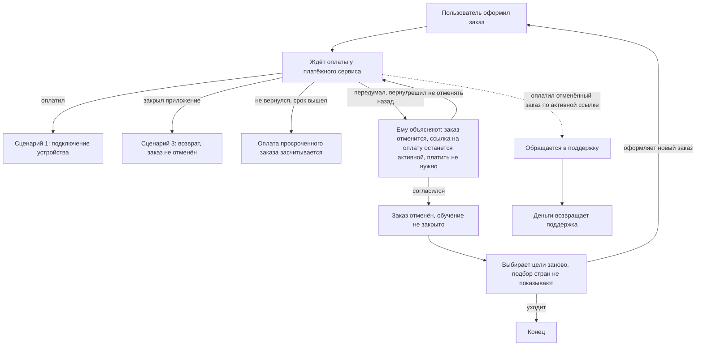

# Пример сценария: «Передумал на этапе заказа» (шаблон Б, ЖР §68)

Пример того, как сценарий выглядит в `.md` и в виде схемы. Основа — сценарий 4 из `research/onboarding_scenarios_draft.md`. Формат — по статье «Как составлять пользовательские сценарии» (bureau.ru/soviet/20260825/, `research/scenarios_birman_format.md`): язык предметной области, интерфейс не упоминается. Сам сценарий пишется в Figma обоими дизайнерами (ЖР §40); этот файл только образец формы.

## 1. Сценарий (основной документ, шаблон Б)

**Роль.** Пользователь, оформивший заказ или ждущий оплаты и решивший не покупать эту страну.

**Когда** пользователь на этапе заказа понимает, что страна ему не подходит или что он передумал, **пользователь хочет** отказаться от заказа и вернуться к выбору, **чтобы** не заплатить за страну, которая ему не подойдёт.

**Ход событий.** Пользователь возвращается на шаг назад. Перед этим ему объясняют: заказ отменится, но ссылка на оплату у платёжного сервиса останется активной, поэтому платить по ней не нужно; он соглашается. Заказ считается отменённым, обучение не закрывается. Пользователь возвращается к выбору целей, подбор стран ему заново не показывают. Он выбирает цели и страну и оформляет новый заказ или уходит.

**Подсценарии**
- Пользователь оплатил отменённый заказ по ещё активной ссылке — обращается в поддержку, деньги возвращает поддержка.
- Пользователь закрыл приложение вместо возврата назад — заказ не отменён (сценарий 3).
- Пользователь оплатил заказ дважды со скопированной ссылки — известное ограничение, порядок возврата денег не решён.
- Пользователь не вернулся назад, и заказ закончился по времени — оплата по просроченному заказу засчитывается как доступ.

*Служебная строка (в сценарий не входит):* покрывает гипотезы Н-В, Н-Б, Н-Г, 4; джобы R4, O3.

## 2. Тот же сценарий схемой (флоу событий, не формат Бирмана)

Схема — это уже флоу (шаг 4 цепочки, ЖР §41), здесь только для сравнения. Блоки описывают события в жизни пользователя, а не экраны. Диаграмма Mermaid: отображается в GitHub и Obsidian.

## 3. Что видно из сравнения

| | Сценарий (текст по Бирману) | Схема (флоу) |
|---|---|---|
| Что передаёт | чего хочет пользователь, в каких обстоятельствах, зачем | развилки, возвраты, кто куда ведёт |
| Чего не хватает | развилки приходится держать в голове | «хочет» и «чтобы» теряются |
| Где живёт | Figma, пишут оба дизайнера (ЖР §40) | после сценариев, шаг 4 (флоу) |
| Про интерфейс | не упоминается | события, не экраны; экраны появятся в тех. карте (шаг 5) |

Строка «Ему объясняют…» в схеме и в сценарии описана на языке пользователя. В продукте это bottom sheet с подтверждением отмены (ЖР §57); такого слова в сценарии быть не должно.
