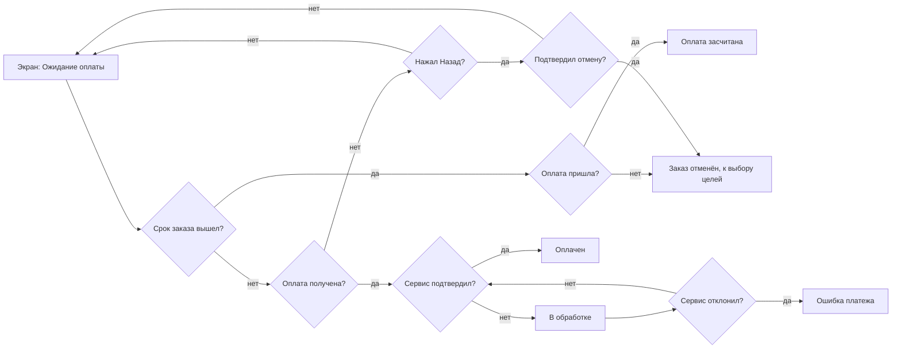
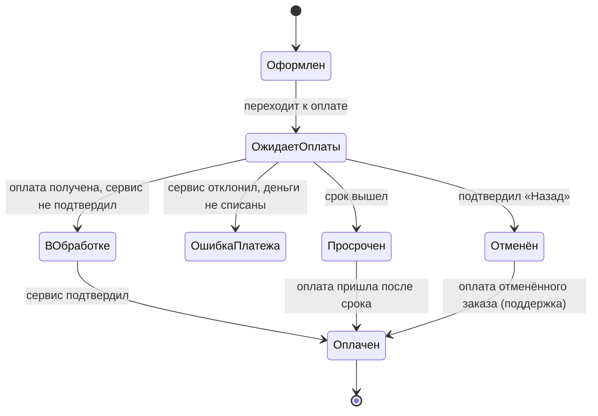
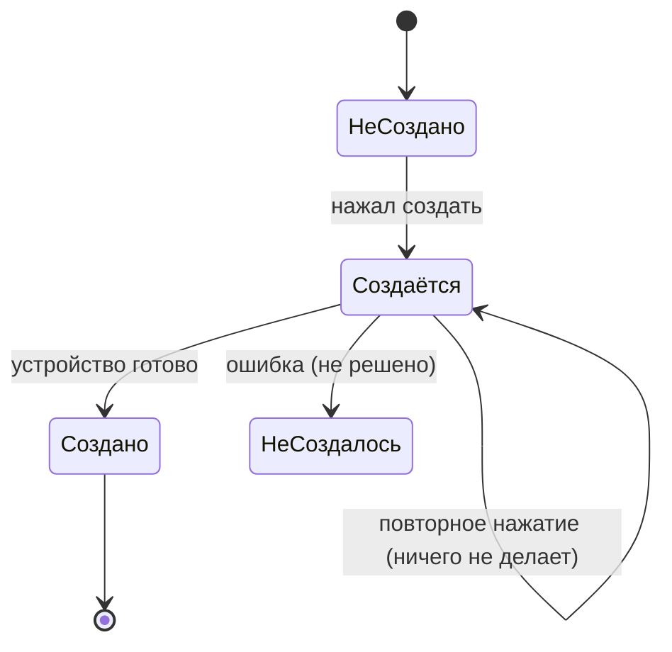
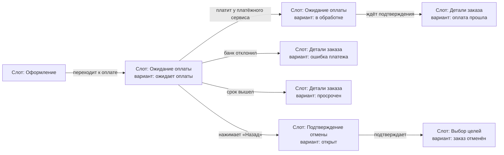
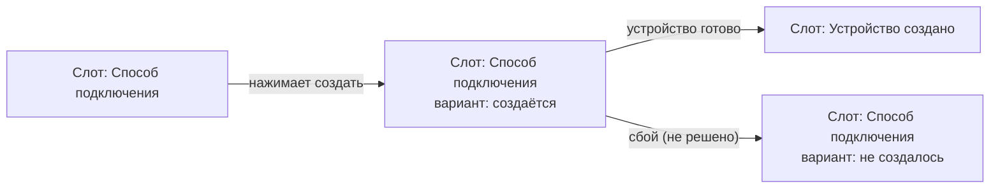
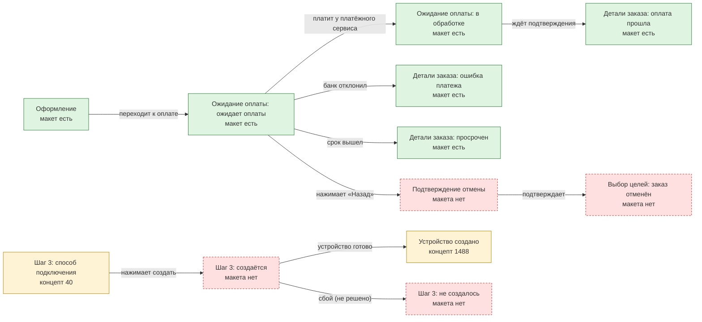

# Вид тех. карты онбординга: источники, критерии, сравнение форм, рекомендация (2026-11-06)

> **Заменено процессом ЖР §124 (2026-11-06):** отдельной тех. карты нет; после флоу — матрица «экран × состояния» (карта экранов), затем экраны со всеми состояниями и спецификация экранов. Пилот: `research/screen_map_pilot_onboarding.md`. Текст ниже — история поиска формы.

Готовит «Исследование» по поручению автора (через Ядрышка). Вопрос автора: тех. карта — это схема-флоу с кучей развилок по каждому тех. состоянию из сценариев или есть более наглядная и понятная форма? Только текст; тех. карту не строил (после выбора вида автором); Figma, гипотезы, порядок §83 не тронуты. Про флоу второго дизайнера не думал, кроме его тех. карты 8056:864 как образца формы (г). Оценки форм мои, автором не утверждены.

**Обновление 2026-11-06 (ЖР §118):** автор изменил главный критерий — «потом на тех. карту натягиваются экраны»; гибрид пока не принят; добавлена форма (е) «флоу экранов / wireflow», сравнение с (д), подсценарии отдельно и итоговая рекомендация — раздел 11. Разделы 1–10 — прежняя версия (ЖР §117).

## 1. Рекомендация (коротко)

**Гибрид: таблица состояний по экранам (основа) + две маленькие диаграммы состояний только для объектов «заказ» и «устройство».** Флоу остаётся без состояний (ЖР §33, Ф15), каждое состояние в таблице связано с подсценарием v5, экраном и выходом. Схему-флоу с развилками на каждое состояние источники не поддерживают: для роста числа состояний они предлагают иерархию состояний (statecharts), таблицы переходов и таблицы решений, а в UX — перечень состояний экрана. Прямого сравнения форм именно для UX-тех. карты в открытых страницах нет, вывод — мой синтез (раздел 8).

## 2. Источники (13 страниц с цитатами; цитаты получены инструментом чтения страниц, дословность не гарантирована)

| № | Источник | Цитата (проверено на странице) | Что даёт |
|---|---|---|---|
| С1 | Wikipedia, «UML state machine» | «UML statecharts introduce the new concepts of hierarchically nested states and orthogonal regions.»; «In UML, states are represented as rounded rectangles labeled with state names.» (иерархия состояний решает рост числа состояний обычного автомата — вывод страницы, не цитата) | диаграмма состояний: состояния и переходы по событиям; иерархия |
| С2 | statecharts.dev, «What is a statechart» | «A statechart is a state machine where each state in the state machine may define its own subordinate state machines, called substates.» | подсостояния для масштабирования |
| С3 | Stately (XState), «State machines and statecharts» | «State machines help us model how a process goes from state to state when an event occurs.»; «Events cause transitions; when an event happens, the machine transitions to the next state.»; «They provide a clear and concise way to model complex user interfaces and manage application state.» | состояния UI как автомат; события вызывают переходы |
| С4 | Wikipedia, «State-transition table» | «all possible inputs to the finite-state machine are enumerated across the columns of the table» (состояния по строкам) | табличная форма того же автомата |
| С5 | Wikipedia, «Finite-state machine» | «It is an abstract machine that can be in exactly one of a finite number of states at any given time.»; автомат «can also be represented by a directed graph called a state diagram» | в каждый момент ровно одно состояние; граф и таблица — две записи одного |
| С6 | Wikipedia, «Decision table» | «decision tables are tabular representations for specifying which actions to perform depending on given conditions.»; «A decision table is considered balanced or complete if it includes every possible combination of input variables.» | таблица условий и действий; проверка полноты |
| С7 | Wikipedia, «Combinatorial explosion» | «the rapid growth of the complexity of a problem due to the way its combinatorics depends on input, constraints and bounds» | почему развилки на каждое состояние разрастаются |
| С8 | Scott Hurff, «How to fix a bad user interface» (UI stack), 2015-08-17 | «Every screen you interact with in a digital product has multiple personalities.»; «It's easy to overlook this state, and many product designers insert it as an afterthought.»; «Too often designers simply fill their screens with whitespace and spinners.» | у каждого экрана несколько состояний; неидеальные состояния забывают |
| С9 | NN/g, K. Kaplan, «Designing Empty States in Complex Applications», 2021-09-19 | «Do not default to totally empty states.»; «Don’t let empty-state design be an afterthought within your application.» | пустые состояния проектируются |
| С10 | NN/g, K. Sherwin, «Progress Indicators…» | «They reassure the user that the system is working and reduce the user’s uncertainty.»; «Without any visual change from the system, most users will assume the action was not registered and they will try again.» | состояния «в обработке»; повтор действия |
| С11 | NN/g, «10 Usability Heuristics» | «The design should always keep users informed about what is going on, through appropriate feedback»; «Error messages should be expressed in plain language (no error codes)» | видимость статуса; ошибки словами |
| С12 | NN/g, «Error-Message Guidelines» (Neusesser, Sunwall) | «Avoid technical jargon and use language familiar to your users instead.»; «Merely stating the problem is also not enough; offer some potential remedies.» | названия и тексты состояний словами пользователя |
| С13 | GOV.UK Design System, «Validation» | «If there’s a validation error, tell the user what’s gone wrong and how to fix it.»; «But minimise your chances of needing to show an error message in the first place» | ошибки: что случилось и что делать |

**Не открыл или страница без текста (не проверено):** Material Design 3 «States» и Apple HIG «Loading» (получил только заголовки), Miro «State diagram» (404), Lucidchart (404), Figma «Design handoff» (404), IxDF «Edge cases» (пусто), NN/g «Status trackers» (404); Harel «Statecharts» (оригинал) не открывал. Источников про «лучшую форму тех. карты в UX» в открытых страницах нет.

## 3. Критерии выбора формы (и обоснование)

| № | Критерий | Почему важен |
|---|---|---|
| К1 | Наглядность | автор читает сам; схему «читают людьми» |
| К2 | Полнота и проверяемость покрытия | главная цель тех. карты: ничего не пропустить; источник С6: полнота проверяется перебором комбинаций |
| К3 | Связь с подсценариями v5 и узлами флоу v2 | чтобы каждое состояние имело основание в сценарии (ЖР §83: цепочка) |
| К4 | Связь с экранами и разработкой | следующий шаг — экраны и передача (PROCESS_GUIDE шаги 6–8) |
| К5 | Масштабируемость | рост числа состояний не должен давать «15000 стрелок» (С7) |
| К6 | Поддержка правок | автор правит; формат должен переживать правки |
| К7 | Чтение людьми | не только разработчиками; слова пользователя (С11, С12) |
| К8 | Чистота (Ф14) | на схеме нет ID Figma и кодов, связь в отдельной связке |

## 4. Сравнение форм (оценки мои: высокая / средняя / низкая)

Формы: **(а)** флоу с развилками по состояниям; **(б)** диаграмма состояний (statechart); **(в)** матрица «экран × состояние: условие, что видит, выход»; **(г)** карточки состояний по колонкам-экранам (как тех. карта второго дизайнера 8056:864: 8 колонок-экранов, карточки «что видит, куда ведёт, основание, статус по цветам», внизу граф состояний устройства); **(д)** гибрид: матрица + диаграммы состояний только для «заказа» и «устройства».

| Критерий | (а) флоу | (б) statechart | (в) матрица | (г) карточки | (д) гибрид |
|---|---|---|---|---|---|
| К1 наглядность | высокая на малом, низкая на большом | высокая для одного объекта, низкая для всех экранов | средняя | высокая | высокая |
| К2 полнота, проверка | низкая (нет перебора комбинаций) | средняя (состояния × события) | высокая (строки пересчитываются, пустые клетки видны) | средняя (нет системной проверки) | высокая |
| К3 связь с v5 и флоу | высокая | средняя | высокая (колонка «подсценарий») | средняя (коды на карточках) | высокая |
| К4 связь с экранами, разработкой | низкая | низкая (состояния объектов, а не экранов) | высокая | высокая | высокая |
| К5 масштабируемость | низкая (рост комбинаторный, С7) | средняя (иерархия, С1–С2) | высокая (рост по строкам) | средняя (рост в ширину) | высокая |
| К6 правки | низкая (перерисовка стрелок) | средняя | высокая | средняя | высокая |
| К7 чтение людьми | средняя | низкая для не технических | высокая | высокая | высокая |
| К8 чистота | низкая (технические слова в развилках) | средняя | высокая | низкая, если коды [1а], Г1 на карточках (у 8056:864 они есть) | высокая |

**Где слаба каждая форма.** (а): число стрелок растёт как произведение условий (С7), состояния «ожидает», «в обработке», «просрочен» превращаются в параллельные дорожки, флоу теряет верхнеуровневость (ЖР §33, Ф3). (б): хорошо описывает один объект, но не говорит, на каком экране что видит пользователь; для всех экранов сразу даёт паутину. (в): не показывает последовательность и допустимые переходы наглядно; нужна вспомогательная диаграмма для объектов. (г): удобна глазу, но проверка полноты ручная, коды на карточках нарушают чистоту (это можно вынести в связку). (д): требует поддерживать два вида, но каждый маленький.

## 5. Пример на онбординге: заказ и устройство

Состояния взяты из журнала и гипотез (ЖР §55–§57, §71 п. 7, §75–§76; гипотезы Н-В, Н-Г, Н-Б; гипотезы выдачи/выпуска второго дизайнера для устройства); неопределённое помечено «не решено». Слова состояний — слова автора: «ожидает оплаты», «в обработке», «оплачен», «ошибка платежа», «просрочен», «отменён».

### 5.1. Форма (а): флоу с развилками по состояниям

Уже 13 развилок и стрелок для одного экрана и одного объекта; добавление «закрыл приложение», «повторная оплата», «оплата отменённого заказа» умножает дорожки.

### 5.2. Форма (б): диаграмма состояний (оба объекта)

Подписи переходов — события. Диаграмма не говорит, какой экран показывается в каждом состоянии.

### 5.3. Форма (в): матрица «экран × состояние»

| Экран | Состояние | Условие | Что видит пользователь | Выход | Связка (основание) |
|---|---|---|---|---|---|
| Ожидание оплаты | ожидает оплаты | заказ оформлен, не оплачен, срок идёт | отсчёт до конца срока; «продолжить оплату» | оплата / «Назад» → подтверждение отмены | Н-В; ЖР §55, §56 |
| Ожидание оплаты | в обработке | деньги получены, сервис не подтвердил | «оплата получена, заказ обрабатывается»; без срока; индикатор; «поддержка» | оплачен | Н-В, Н-Г; ЖР §75 п. 1 |
| Детали заказа | оплачен | сервис подтвердил | что куплено, срок доступа | дальше к созданию устройства | Н-Г |
| Детали заказа | ошибка платежа | сервис отклонил | «деньги не списаны» и причина, если сервис прислал | не решено (повтор оплаты не рисуем) | гипотеза истории оплат |
| Детали заказа | просрочен | срок вышел | «деньги не списаны, доступ можно оформить снова» | возврат к началу; оплата после срока засчитывается | ЖР §71 п. 7; Н-Г |
| Выбор целей | заказ отменён | подтвердил «Назад» | возврат к выбору целей, без показа подбора | выбор целей | ЖР §56 п. 2, §76 п. 2 |
| Шаг 3 «создание» | устройство создаётся | нажал создать | кнопка «Создаём…», повторное нажатие не работает, место занято | устройство создано | гипотеза «Создаём…» |
| Шаг 3 «создание» | устройство не создалось | сбой | не решено | не решено | вопрос автору |

### 5.4. Форма (г): карточки по колонкам-экранам

Колонка «Ожидание оплаты»: карточки [Ожидает оплаты | Что видит: отсчёт, «продолжить оплату» | → Оплата / Подтверждение отмены | основание Н-В | статус: решено], [В обработке | Что видит: «оплата получена, заказ обрабатывается» | → Оплачен | основание Н-В, Н-Г | статус: решено]; колонка «Детали заказа»: [Оплачен …], [Ошибка платежа … статус: не решено], [Просрочен …]; внизу граф «Заказ: состояния и переходы». Цвет карточки — статус (как в 8056:864). Читается быстро, но при 30+ карточках нужно искать глазами, а коды основания лежат на самих карточках.

### 5.5. Форма (д): гибрид

Матрица из 5.3 как основная таблица + диаграммы из 5.2 (только «заказ» и «устройство», по 6–9 состояний) + таблица проверки полноты:

| Подсценарий v5 | Затронутые состояния | Экран |
|---|---|---|
| Оплата не прошла | заказ: ошибка платежа | Детали заказа |
| Прервался на полпути | заказ: ожидает оплаты, просрочен; устройство: создаётся, не создалось (не решено) | Ожидание оплаты; Шаг 3 |
| Передумал и отказался | заказ: отменён | Выбор целей |
| Нужно настроить на другом устройстве | устройство: создано | Шаг 3, экран результата |
| Подключил, но нужное не заработало | устройство: создано (статус «активен сейчас» вне этой карты) | экран результата |
| Сомневается в выборе; За границей… | нет тех. состояний (путь пользователя, флоу) | — |

Пустая клетка таблицы проверки видна сразу: «не создалось» без решения; это и есть проверка полноты (по логике С6: перебор комбинаций).

## 6. Что остаётся во флоу, а что уходит в тех. карту (ЖР §33, Ф15)

Во флоу: шаги пользователя, экраны с общими названиями, ромбы-решения продукта, исходы (отмена через «Назад», «Пропустить», «уходит», «поддержка»). В тех. карту: состояния экранов и объектов, не меняющие путь: «ожидает оплаты», «в обработке», «ошибка платежа» (если нет выбора пользователя), «просрочен», «создаётся», пустые, загрузочные, ошибки, лимиты, техработы, защита от повторного нажатия.

## 7. Именование состояний

Слова автора и пользователя: «ожидает оплаты», «в обработке», «оплачен», «ошибка платежа», «просрочен», «отменён», «не создано», «создаётся», «создано», «не создалось». Без жаргона и кодов (С11, С12): «деньги не списаны», а не «failed»; «Создаём…» — текст кнопки, а не имя состояния.

## 8. Вывод и где рамка вопроса не поддержана

- **«Схема-флоу с развилками на каждое состояние» источниками не поддерживается.** С7 показывает, что комбинаторный рост — известная проблема; С1–С2 решают её иерархией состояний, С4–С6 — таблицами. В UX-источниках (С8–С10) состояния описываются как набор состояний экрана («multiple personalities»), а не как ветки пути.
- **Есть более наглядная форма: гибрид (д).** Таблица даёт полноту и связь с экранами (К2, К4, К6), две маленькие диаграммы — наглядность жизни объектов «заказ» и «устройство» (К1). Это мой синтез: прямого сравнения форм для тех. карты в открытых страницах нет (не проверено).
- **Что слабо в рекомендации:** требует поддержки двух видов; матрица плохо показывает последовательность (для неё и нужны диаграммы); оценки форм субъективны.

## 9. Что нужно от автора

1. Выбрать вид: гибрид (д), только таблица (в), карточки (г) или другой.
2. Подтвердить список объектов и состояний (заказ: 7 состояний — оформлен, ожидает оплаты, в обработке, оплачен, ошибка платежа, просрочен, отменён; устройство: 4 — не создано, создаётся, создано, не создалось) и слова состояний.
3. Решить неопределённое: что происходит при «не создалось» (во флоу есть исходы «уходит» и «поддержка»; что видит пользователь — не решено), «закрыл во время создания» (создастся ли устройство), «ошибка платежа» (повтор оплаты не рисуем).
4. Если выбран гибрид: колонку «Связка (основание)» держать отдельным листом, чтобы тех. карта оставалась чистой (Ф14).

## 10. Что не проверено

Дословность цитат; Material, Apple HIG, Miro, Lucidchart, Figma handoff, IxDF edge cases, NN/g status trackers не открылись; Harel (оригинал) не открывал; прямых источников «лучшая форма тех. карты» нет; состояния и переходы заказа и устройства собраны из журнала и гипотез, возможны пробелы (помечены «не решено»); оценки форм мои.

---

## 11. Решение автора: экраны ложатся на карту (ЖР §118)

> **Пересматривается (2026-11-06):** форма тех. карты (гибрид / wireflow) проверяется на валидность, см. `research/tech_map_validity.md`. Решения нет — решает автор.

### 11.1. Новый главный критерий и форма (е)

**К9 «Экраны ложатся на карту» (главный по решению автора):** на карте есть слот под реальный макет (название, размер), на стрелке подпись действия пользователя, состояние — тот же экран с изменённым элементом (вариант слота), ошибка — ответвление, варианты экрана поддерживаются.

**Форма (е) «флоу экранов / wireflow»** (формат автора): экран-слот → стрелка «действие пользователя» → следующий экран ИЛИ тот же экран с изменённым элементом; ответвления вниз — ошибки и справочные экраны (например «Как это работает» → тот же экран с bottom sheet); слои названы «flow», «text», имена макетов.

**Источники по (е) (страницы с цитатами; дословность не гарантирована):**

| № | Источник | Цитата (проверено на странице) | Что даёт |
|---|---|---|---|
| Е1 | NN/g, P. Laubheimer, «Wireflows» (раздел 1, С. №2 основной части) | «one can visualize only the elements that do change due to user input.»; «They are well suited for representing dynamic changes on one or few pages inside an app»; «each wireframe corresponds to the same app page, rather than representing different app pages»; «work less well for capturing flows through a large number of relatively static pages linked together» | состояние как тот же экран с изменением; граница применимости: один-несколько экранов, не большой набор статичных страниц |
| Е2 | Balsamiq, M. Angeles, «Wireflows» | «Focus on the screens where something in the interface changes»; «These paths help you catch gaps or edge cases early and make your flow more complete.»; «Wireflows are most effective when they're low-fidelity.» | экраны с изменениями; ошибочные ветки ловят пропуски |
| Е3 | RapidNative, «Screen Flow Diagrams» (блог) | «A screen flow diagram is a visual map of the screens, interactions, and decision points in a digital product.»; «Now add loading, empty, error, success, and abandon branches.»; «UX guidance recommends breaking a task into about 4 to 8 subtasks, from entry to completion.» | состояния ветками; размер карты задачи 4–8 шагов (по утверждению блога) |
| Е4 | UI/UX Atlas (блог), «Wireframing, Wireflows & Promptframes» | «A wireflow is a wireframe fused with a user flow diagram.»; «Use a wireflow to map all states (empty, error, success, loading)» | wireflow как карта всех состояний |
| Е5 | Scott Hurff (С8 раздела 2) | «Every screen you interact with in a digital product has multiple personalities.» | у экрана несколько вариантов |

**Не открылись:** Miro «Wireflow» (404), Figma «Wireflow» (404); Smashing не найден. Е3–Е4 — блоги, авторитет низкий; Е1 — основной.

### 11.2. Сравнение (е) и (д) по новому и прежним критериям (оценки мои)

| Критерий | (е) wireflow | (д) гибрид (таблица + диаграммы) |
|---|---|---|
| **К9 экраны ложатся (главный)** | **высокая:** слот под макет, подпись, размер, варианты | средняя: экраны названы в таблице, слота нет; диаграммы низкая |
| К1 наглядность | высокая (видны экраны) | высокая |
| К2 полнота и проверка | **средняя:** нет перебора, ошибки ответвлением можно пропустить; нужна проверочная таблица | высокая |
| К3 связь с v5 и флоу v2 | высокая: слоты = экраны флоу v2, карта = подсценарий | высокая |
| К4 экраны и разработка | высокая | высокая |
| К5 масштабируемость | средняя: новые состояния — варианты слота, но ответвления ошибок растут; Е1: плохо для большого числа статичных страниц | высокая |
| К6 правки | средняя: макеты обновляются через ссылки, стрелки правятся вручную | высокая |
| К7 чтение людьми | высокая | высокая |
| К8 чистота (Ф14) | средняя: макеты на тех. карте уместны (Ф14 касается флоу), но ID и коды в слоях и подписях нельзя выносить на видимое поле | высокая |

**Где (е) выигрывает:** главный критерий К9; состояние как «тот же экран с изменением» (Е1) естественно ложится на варианты компонента; читается без объяснений; совпадает с экранами флоу v2.
**Где проигрывает:** нет встроенной проверки полноты (в таблице пустая клетка видна, на схеме пропуск незаметен, Е2 говорит только, что ошибочные ветки помогают ловить пропуски); рост числа состояний даёт рост ответвлений; нет картины жизни объекта «заказ» и «устройство» целиком (для этого диаграмма (б)); при большом числе экранов Е1 прямо не рекомендует wireflow.
**Честный вывод:** по новому главному критерию (е) лучше (д); по полноте и масштабу хуже. Поэтому не (е) вместо (д), а (е) как основной вид + лёгкая проверка полноты.

### 11.3. Подсценарии отдельно или одна карта

| Критерий | Отдельная карта на подсценарий | Одна карта на онбординг |
|---|---|---|
| Читаемость | плюс: одна история, 4–8 слотов (Е3) | минус: все 7 историй в одном холсте, много ответвлений |
| Правки | плюс: локальны | минус: каскадные |
| Сверка с v5 | плюс: карта = подсценарий | минус: нужен свод |
| Общие экраны (напр. «Ожидание оплаты» встречается в «Прервался», «Передумал», «Оплата не прошла») | минус: дубли слотов; рассинхрон при правке | плюс: один слот |
| Ссылки между картами | минус: нужны ссылки | не нужны |
| Проверка полноты по экрану (все ли варианты экрана X нарисованы) | минус: нужен свод по экранам | плюс |
| Размер | 5 небольших карт | одна большая карта |

**Какие подсценарии v5 нуждаются в карте:** «Передумал и отказался», «Прервался на полпути», «Оплата не прошла», «Нужно настроить на другом устройстве», «Подключил, но нужное не заработало». У «Сомневается в выборе» и «За границей…» тех. состояний нет (путь пользователя), карты не нужны (в таблице проверки пометка).
**Рекомендация:** карты по подсценариям v5 (маршрут по слотам), общие экраны как **один компонент с вариантами** на всех картах (дубли слотов — копии компонента, а не новые макеты) + отдельная таблица «экран × варианты» как единственный источник правды и проверка полноты.

### 11.4. Итоговая рекомендация вида

**(е) wireflow по подсценариям + таблица состояний «экран × вариант» для проверки полноты;** диаграммы состояний заказа и устройства — по необходимости (если автору нужна картина жизни объекта), не обязательны. Обоснование: главный критерий К9 выполняется только (е); слабость (е) по полноте закрывается таблицей (С6, перебор комбинаций), которая у нас уже есть в разделе 5.3. Я не согласен с автором только в одном: (е) без проверочной таблицы не даёт гарантии полноты.

### 11.5. Пример на онбординге в форме (е): 9 вариантов

Состояния: заказ — ожидает оплаты, в обработке, оплата прошла, просрочен, ошибка платежа, отменён; устройство — создаётся, создано, не создалось (не решено). «Слот» — рамка под реальный макет; «вариант» — тот же экран с изменённым элементом.

Подписи — действия пользователя; ответвления вниз — ошибка, срок, «Назад». Названия слотов — общие названия экранов; ID и коды в слоях не выносятся на поле (связка отдельным листом).

### 11.6. Шаблон 8138:44198: оценка блоков по auto-layout

Источник: `research/tech_map_template_dump.md` (Дизайн, d92306c, read-only дамп шаблона автора). Шаблон — пример «Пополнение хранилища» из другого продукта: горизонтальная лента `flow` (auto-layout H, gap 0) из 5 экранов `t-<тип> | large[ | вариант]` 402×874 и 4 подписей `text` шириной 480; сверху плашка `plank`; отдельно вертикальный вариант подписи (ответвление вниз, для bottom sheet) и образец экрана. Узлов-стрелок, ромбов, овалов нет; «стрелка» — линия 3 px под подписью (наконечников в дампе нет).

**Что удобно (оставить).**
- Пара «экран + подпись» — повторяющаяся единица, собирается auto-layout H без зазоров; подпись одной строкой «глагол + объект» привязана к переходу линией, а не коннектором — не отваливается при перестановке.
- В экране лежит реальный макет (заглушек нет), имя слоя несёт тип, размер устройства и третьим сегментом вариант/состояние: это уже «слот + вариант».
- Рамка телефона (`bezel`), безопасная зона (`safearea`), хром (`header`, `indicator`) выключены; варианты оверлеев (`bottom sheet body`, `toast`) подключаются поверх экрана.
- Плашка `plank` с названием карты шириной в ленту; ширина экрана (402) одна на всех.

**Чего не хватает для тех. карты.**
1. **Видимое имя варианта.** Вариант (состояние) только в имени слоя, на карте его не видно; для тех. карты нужна подпись под экраном («ожидает оплаты», «в обработке»).
2. **Отметка изменённого элемента.** В примере автора состояние = тот же экран с изменением; шаблон не помечает, что изменилось (рамка, подсветка), и это нужно, чтобы читатель увидел разницу без сравнения глазами.
3. **Ошибка и ветвление.** Есть один вертикальный вариант подписи под лентой; нет типа «ошибка» и второй дорожки (ряда): ответвлений больше одного не нарисовать без ручной раскладки.
4. **Ссылка на смежную карту.** Блока «→ карта …» нет (аналог овала Ф19).
5. **Наконечник стрелки.** Направление задаёт порядок слева направо; для ответвлений вниз и возвратов нужен наконечник.
6. **Высота подписи подогнана вручную** (754, 414, 802, 802 px): при добавлении экрана ленту придётся править; лучше растягивать подпись по высоте ленты и центрировать текст.
7. **Продуктовая палитра и шрифты чужие** (Fira Sans, SF Pro; `bg/page` #0e1526), у BittVPN свои токены (AGENTS.md: `bg/page` #0A0C0F, Martian Grotesk): использовать токены BittVPN.
8. **Хром Telegram/iOS** внутри экрана (`header` — Header TMA (iOS), статусбар) допустим только выключенным: в продуктовый макет его тащить нельзя (AGENTS.md).

**Предлагаемый набор блоков и свойств (Figma components/variants).**

| Блок | Назначение | Свойства (properties) |
|---|---|---|
| `tm/screen` | слот под реальный макет | `screen` (instance swap: реальный экран), `variant` (текст: «ожидает оплаты»; показывается подписью под слотом), `change` (boolean: рамка вокруг изменённого элемента; сам элемент выбирает дизайнер), `overlay` (none / bottom sheet / toast), `chrome` (hide / show; по умолчанию hide), `kind` (main / error / branch: обводка и подпись) |
| `tm/step` | стрелка с действием пользователя | `direction` (right / down / return), `text` (глагол + объект: «Выбирает предметы»), `kind` (main / branch / error), `arrowhead` (boolean, по умолчанию true) |
| `tm/link` | ссылка на смежную карту | `target` (название: «Карта «Оплата не прошла»»), `direction` |
| `tm/title` | плашка с названием карты | `title`, `scenario` (подсценарий v5 текстом, без кодов) |
| `tm/lane` | ряд-лента | auto-layout H, gap 0, counter center, лимит 5–6 слотов в ряду |
| `tm/map` | карта | auto-layout V: плашка + ряды (gap 80), ответвления — второй ряд под основным |

**Правила раскладки.** Основной маршрут слева направо в одном ряду; ответвления и ошибки — рядом ниже, вертикальной подписью; не более 5–6 слотов в ряду (в шаблоне 5; RapidNative рекомендует 4–8 шагов); подпись растягивается по высоте ряда и центрируется; ширина слота и подписи фиксированы (402 и 480), поэтому ряд из 5 слотов ≈ 4400 px.
**Именование слоёв.** Сохранить схему автора: `t-<экран> | large | <вариант>`, `flow`, `text`, `plank`; вариант — слова автора («ожидает оплаты»), без кодов и ID; технические сегменты не показывать на видимом поле (Ф14).
**Чистота.** Слои `safearea`, `bezel`, `header`, `indicator` скрыты; подписи без номеров гипотез и джобов; связь с v5 — отдельной таблицей-связкой.

### 11.7. Режим заглушки: макетов онбординга пока нет (ЖР §119)

**Решение автора:** вид принят — wireflow по подсценариям + таблица «экран × вариант», блоки `tm/screen`, `tm/step`, `tm/link`, `tm/title`, `tm/lane`, `tm/map`. Условие: экранов онбординга нет, макеты потом делают по тех. карте и «натягивают» на неё.

**Блок `tm/screen` в режиме заглушки.** Свойства: `mockup` (нет / есть), `screen` (общее название экрана текстом), `variant` (текст), `change` (текст: что изменилось и чем вариант отличается; только то, что есть во вводных), `requirement` (текст: что должно быть видно; для «макета нет»), `kind` (main / error / branch). Внешний вид при `mockup=нет`: рамка 402×874 пунктиром, внутри название экрана, вариант, `change` и подпись «макета нет»; при `mockup=есть` вместо заглушки instance swap реального макета (узел Figma хранится в описании слоя, не на видимом поле, Ф14). Имя слоя прежнее: `t-<экран> | large | <вариант>`; замена заглушки макетом не меняет имя и размер слота. Остальные блоки (`tm/step`, `tm/link`, `tm/title`, `tm/lane`, `tm/map`) не зависят от наличия макета.

**Инвентарь слотов: экраны и варианты флоу онбординга v2 и подсценариев v5.** «Есть» — макет в проекте (узел из AGENTS.md и `src/screens/*/*.md`) или по тех. карте второго дизайнера 8056:864 («по тех. карте, не проверено» — узел назван там, в Figma не открывал). «Нет» — макета в проекте нет; для таких слотов в последнем столбце требование к будущему макету из журнала и гипотез, без придуманных деталей.

| Экран | Вариант | Макет | Узел / источник | Требование к будущему макету («нет») |
|---|---|---|---|---|
| Приветствие | основной | нет | экрана онбординга в проекте нет | можно начать подбор и можно пропустить (ЖР §47, §72); текст и название кнопки «Пропустить» уточнятся (не решено) |
| Приветствие | пропуск | нет | то же | переход на «Главную» без возврата в онбординг (ЖР §71 п. 5, §77) |
| Выбор целей | основной | нет | — | выбор целей; число целей и счётчик (гипотеза 2) не решены, число целей 7 или 8 ждёт решения (ЖР §4); цель про российские сервисы (гипотеза 10) |
| Рекомендация страны | основной | нет | — | рекомендованная страна, видны совпавшие цели (гипотезы 3, 4 по названиям, содержание перечитать); возможность смотреть остальные |
| Детали страны | не куплена | есть | `6643:24352` (CountryScreen, available) | — |
| Детали заказа / Оформление | основной | есть | `6606:23733` (Checkout) | — |
| Детали заказа / Оформление | все опции + бонусный баланс | есть | `7223:25096`; сведения о бонусах `7223:25222` | — |
| Выбор срока | шит | есть | `7166:121702`, `7166:122124`, `7171:123356` (PurchaseDurationSheet) | — |
| Способ оплаты | шит | есть | `7370:32834`, состояние `7370:30600` | — |
| Статус заказа | ожидает оплаты | есть | `6128:23570` | — |
| Статус заказа | ожидает оплаты, загрузка | есть | `6532:50286` | — |
| Статус заказа | в обработке | есть | `6128:23670` | — |
| Статус заказа | оплата прошла | есть | `6128:23400` (Оплачено); вариант «новая страна, кнопка «Подключиться»» — по тех. карте `7666:28233`, не проверено | — |
| Статус заказа | ошибка платежа | есть | `6137:30574` | — |
| Статус заказа | просрочен | есть | `6409:29297` | — |
| Подтверждение отмены | шит «Назад» | нет | — | заголовок «Вернуться назад?», текст о том, что заказ отменится и подбор начнётся заново, кнопки danger «Подтвердить» и secondary «Отмена»; точный текст автор доработает на экране (ЖР §76) |
| Выбор целей | заказ отменён | нет | — | возврат к выбору целей без показа подбора (ЖР §56 п. 2, §76 п. 2) |
| Оплата прошла (экран пропуска) | с кнопкой «Подключиться» | частично | по тех. карте `7666:28233`; «Онбординг» `7727:28892` с кнопками «Подключить устройство», «Сделаю позже» (там же «частично: свести к одной кнопке «Подключиться»») — не проверено; автор: макетов онбординга нет | какая кнопка основная и как пропустить — не решено |
| Страна (куплена) | нет устройств | есть | `7341:28790` (по тех. карте, не проверено) | — |
| Страна (куплена) | есть место | есть | `6413:30655` (по тех. карте, не проверено) | — |
| Страна (куплена) | лимит | есть | `6440:34482` (по тех. карте), в проекте `6447:27934` | — |
| Страна (куплена) | техработы | есть | `6520:46426` | — |
| Главная | карточка «не подключено» | частично | `6429:29217` (t-main); пометка «не подключено» с названием «уточнится» — по тех. карте | название пометки не решено |
| Шаг 1 «Платформа» | основной | концепт | «концепт 38» (по тех. карте; номер концепта, узел Figma не назван) | 6 платформ с иконками, индикатор «шаг N из 3», предвыбор платформы только если определяется однозначно (гипотеза выпуска) |
| Шаг 2 «Название» | основной | концепт | «концепт 39» | имя по умолчанию, подсказки, правило ввода под полем |
| Шаг 2 «Название» | ошибка ввода | нет | — | ошибка сразу при вводе (латиница и цифры, без пробелов) |
| Шаг 2 «Название» | имя занято | нет | — | предложить другое имя (формат не решён) |
| Шаг 3 «Способ подключения» | основной | концепт | «концепт 40» | способ по умолчанию выбран, строка о способе без терминов |
| Шаг 3 | создаётся | нет | «состояния нет в макетах» (тех. карта) | кнопка в состоянии «Создаём…», заблокирована, повторное нажатие ничего не делает; по образцу «Удаляем…» |
| Шаг 3 | не создалось | нет | — | **не решено** (ЖР §112: исходы «уходит» и «поддержка» есть, экран ошибки не определён) |
| Устройство создано | основной | концепт | «концепт 1488», название экрана уточнится (по решению автора «Устройство создано») | имя и платформа нового устройства; дальше выдача файла |
| Купленная страна | после создания | есть | `6413:30655` (список устройств, новое первым) | — |

**Итог инвентаря.** Всего строк 32: «есть» 16 (экраны страны, оформления, сроков, оплаты, статусов, купленной страны), «частично» 2 (экран пропуска после оплаты, карточка «не подключено» на Главной), «концепт» 4 (шаги 1–3 и «Устройство создано»), «нет» 10 (Приветствие ×2, Выбор целей ×2, Рекомендация страны, Подтверждение отмены, ошибка ввода имени, имя занято, создаётся, не создалось). Для всех «нет» в таблице записано требование из журнала и гипотез; где вводных нет — «не решено».

**Влияние на рекомендацию и пример.** Рекомендация вида не меняется: wireflow по подсценариям + таблица «экран × вариант» (она же инвентарь слотов). Тех. карта строится для экранов, которых нет, как требования к будущему макету; слоты с готовыми макетами сразу получают instance swap. Пример 11.5 в режиме заглушки: макеты есть у «Оформление», «Ожидание оплаты» (ожидает оплаты, в обработке), «Детали заказа» (оплата прошла, ошибка платежа, просрочен), «Устройство создано» — концепт; заглушки у «Подтверждение отмены», «Выбор целей» (заказ отменён), «Шаг 3» (создаётся, не создалось).

Заглушки (красные) заменяются реальным макетом без изменения карты; зелёные уже содержат макеты проекта; жёлтые — концепты второго дизайнера.

### 11.8. Что не проверено (раздел 11)

Miro и Figma «Wireflow» не открылись; Е3 и Е4 — блоги; оценки форм мои; пример (е) собран из журнала, неопределённые состояния помечены; шаблон 8138:44198 оценён по дампу Дизайна (в Figma не открывал); наконечники стрелок в дампе не найдены (проверить в шаблоне); инвентарь макетов: узлы из AGENTS.md и `src/screens/*/*.md`, узлы «по тех. карте» (7666:28233, 7727:28892, 7341:28790, 6413:30655, 6440:34482) и «концепты» 38–40, 1488 в Figma не проверялись; автор сказал, что макетов онбординга нет, а тех. карта 8056:864 называет экран «Онбординг» 7727:28892 — расхождение.
