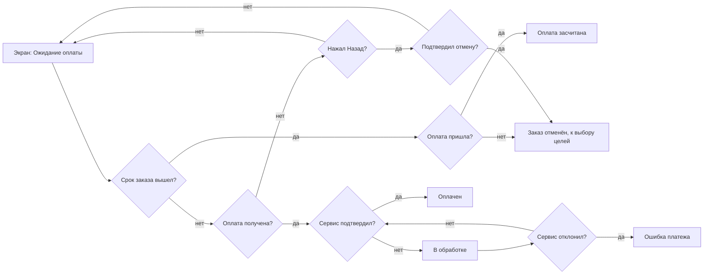
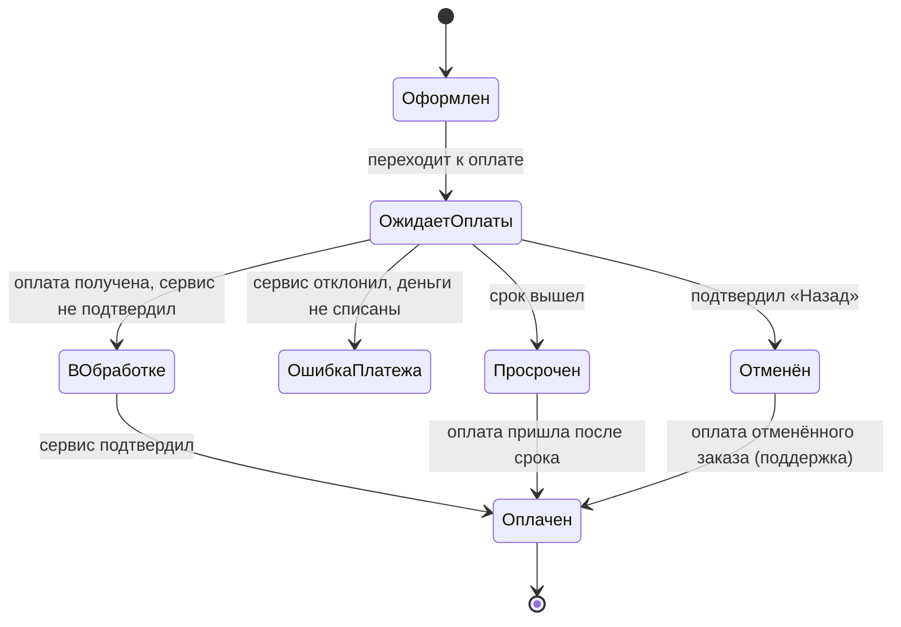
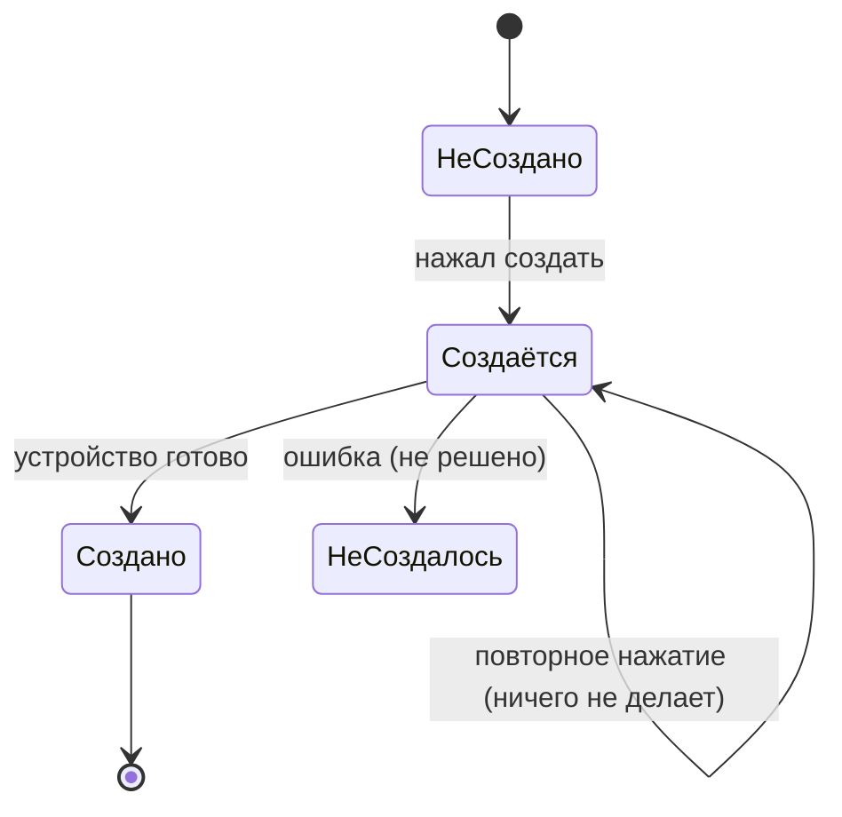

# Вид тех. карты онбординга: источники, критерии, сравнение форм, рекомендация (2026-11-06)

Готовит «Исследование» по поручению автора (через Ядрышка). Вопрос автора: тех. карта — это схема-флоу с кучей развилок по каждому тех. состоянию из сценариев или есть более наглядная и понятная форма? Только текст; тех. карту не строил (после выбора вида автором); Figma, гипотезы, порядок §83 не тронуты. Про флоу второго дизайнера не думал, кроме его тех. карты 8056:864 как образца формы (г). Оценки форм мои, автором не утверждены.

## 1. Рекомендация (коротко)

**Гибрид: таблица состояний по экранам (основа) + две маленькие диаграммы состояний только для объектов «заказ» и «устройство».** Флоу остаётся без состояний (ЖР §33, Ф15), каждое состояние в таблице связано с подсценарием v5, экраном и выходом. Схему-флоу с развилками на каждое состояние источники не поддерживают: для роста числа состояний они предлагают иерархию состояний (statecharts), таблицы переходов и таблицы решений, а в UX — перечень состояний экрана. Прямого сравнения форм именно для UX-тех. карты в открытых страницах нет, вывод — мой синтез (раздел 8).

## 2. Источники (13 страниц с цитатами; цитаты получены инструментом чтения страниц, дословность не гарантирована)

| № | Источник | Цитата (проверено на странице) | Что даёт |
|---|---|---|---|
| С1 | Wikipedia, «UML state machine» | «UML statecharts introduce the new concepts of hierarchically nested states and orthogonal regions.»; «In UML, states are represented as rounded rectangles labeled with state names.» (иерархия состояний решает рост числа состояний обычного автомата — вывод страницы, не цитата) | диаграмма состояний: состояния и переходы по событиям; иерархия |
| С2 | statecharts.dev, «What is a statechart» | «A statechart is a state machine where each state in the state machine may define its own subordinate state machines, called substates.» | подсостояния для масштабирования |
| С3 | Stately (XState), «State machines and statecharts» | «State machines help us model how a process goes from state to state when an event occurs.»; «Events cause transitions; when an event happens, the machine transitions to the next state.»; «They provide a clear and concise way to model complex user interfaces and manage application state.» | состояния UI как автомат; события вызывают переходы |
| С4 | Wikipedia, «State-transition table» | «all possible inputs to the finite-state machine are enumerated across the columns of the table» (состояния по строкам) | табличная форма того же автомата |
| С5 | Wikipedia, «Finite-state machine» | «It is an abstract machine that can be in exactly one of a finite number of states at any given time.»; автомат «can also be represented by a directed graph called a state diagram» | в каждый момент ровно одно состояние; граф и таблица — две записи одного |
| С6 | Wikipedia, «Decision table» | «decision tables are tabular representations for specifying which actions to perform depending on given conditions.»; «A decision table is considered balanced or complete if it includes every possible combination of input variables.» | таблица условий и действий; проверка полноты |
| С7 | Wikipedia, «Combinatorial explosion» | «the rapid growth of the complexity of a problem due to the way its combinatorics depends on input, constraints and bounds» | почему развилки на каждое состояние разрастаются |
| С8 | Scott Hurff, «How to fix a bad user interface» (UI stack), 2015-08-17 | «Every screen you interact with in a digital product has multiple personalities.»; «It's easy to overlook this state, and many product designers insert it as an afterthought.»; «Too often designers simply fill their screens with whitespace and spinners.» | у каждого экрана несколько состояний; неидеальные состояния забывают |
| С9 | NN/g, K. Kaplan, «Designing Empty States in Complex Applications», 2021-09-19 | «Do not default to totally empty states.»; «Don’t let empty-state design be an afterthought within your application.» | пустые состояния проектируются |
| С10 | NN/g, K. Sherwin, «Progress Indicators…» | «They reassure the user that the system is working and reduce the user’s uncertainty.»; «Without any visual change from the system, most users will assume the action was not registered and they will try again.» | состояния «в обработке»; повтор действия |
| С11 | NN/g, «10 Usability Heuristics» | «The design should always keep users informed about what is going on, through appropriate feedback»; «Error messages should be expressed in plain language (no error codes)» | видимость статуса; ошибки словами |
| С12 | NN/g, «Error-Message Guidelines» (Neusesser, Sunwall) | «Avoid technical jargon and use language familiar to your users instead.»; «Merely stating the problem is also not enough; offer some potential remedies.» | названия и тексты состояний словами пользователя |
| С13 | GOV.UK Design System, «Validation» | «If there’s a validation error, tell the user what’s gone wrong and how to fix it.»; «But minimise your chances of needing to show an error message in the first place» | ошибки: что случилось и что делать |

**Не открыл или страница без текста (не проверено):** Material Design 3 «States» и Apple HIG «Loading» (получил только заголовки), Miro «State diagram» (404), Lucidchart (404), Figma «Design handoff» (404), IxDF «Edge cases» (пусто), NN/g «Status trackers» (404); Harel «Statecharts» (оригинал) не открывал. Источников про «лучшую форму тех. карты в UX» в открытых страницах нет.

## 3. Критерии выбора формы (и обоснование)

| № | Критерий | Почему важен |
|---|---|---|
| К1 | Наглядность | автор читает сам; схему «читают людьми» |
| К2 | Полнота и проверяемость покрытия | главная цель тех. карты: ничего не пропустить; источник С6: полнота проверяется перебором комбинаций |
| К3 | Связь с подсценариями v5 и узлами флоу v2 | чтобы каждое состояние имело основание в сценарии (ЖР §83: цепочка) |
| К4 | Связь с экранами и разработкой | следующий шаг — экраны и передача (PROCESS_GUIDE шаги 6–8) |
| К5 | Масштабируемость | рост числа состояний не должен давать «15000 стрелок» (С7) |
| К6 | Поддержка правок | автор правит; формат должен переживать правки |
| К7 | Чтение людьми | не только разработчиками; слова пользователя (С11, С12) |
| К8 | Чистота (Ф14) | на схеме нет ID Figma и кодов, связь в отдельной связке |

## 4. Сравнение форм (оценки мои: высокая / средняя / низкая)

Формы: **(а)** флоу с развилками по состояниям; **(б)** диаграмма состояний (statechart); **(в)** матрица «экран × состояние: условие, что видит, выход»; **(г)** карточки состояний по колонкам-экранам (как тех. карта второго дизайнера 8056:864: 8 колонок-экранов, карточки «что видит, куда ведёт, основание, статус по цветам», внизу граф состояний устройства); **(д)** гибрид: матрица + диаграммы состояний только для «заказа» и «устройства».

| Критерий | (а) флоу | (б) statechart | (в) матрица | (г) карточки | (д) гибрид |
|---|---|---|---|---|---|
| К1 наглядность | высокая на малом, низкая на большом | высокая для одного объекта, низкая для всех экранов | средняя | высокая | высокая |
| К2 полнота, проверка | низкая (нет перебора комбинаций) | средняя (состояния × события) | высокая (строки пересчитываются, пустые клетки видны) | средняя (нет системной проверки) | высокая |
| К3 связь с v5 и флоу | высокая | средняя | высокая (колонка «подсценарий») | средняя (коды на карточках) | высокая |
| К4 связь с экранами, разработкой | низкая | низкая (состояния объектов, а не экранов) | высокая | высокая | высокая |
| К5 масштабируемость | низкая (рост комбинаторный, С7) | средняя (иерархия, С1–С2) | высокая (рост по строкам) | средняя (рост в ширину) | высокая |
| К6 правки | низкая (перерисовка стрелок) | средняя | высокая | средняя | высокая |
| К7 чтение людьми | средняя | низкая для не технических | высокая | высокая | высокая |
| К8 чистота | низкая (технические слова в развилках) | средняя | высокая | низкая, если коды [1а], Г1 на карточках (у 8056:864 они есть) | высокая |

**Где слаба каждая форма.** (а): число стрелок растёт как произведение условий (С7), состояния «ожидает», «в обработке», «просрочен» превращаются в параллельные дорожки, флоу теряет верхнеуровневость (ЖР §33, Ф3). (б): хорошо описывает один объект, но не говорит, на каком экране что видит пользователь; для всех экранов сразу даёт паутину. (в): не показывает последовательность и допустимые переходы наглядно; нужна вспомогательная диаграмма для объектов. (г): удобна глазу, но проверка полноты ручная, коды на карточках нарушают чистоту (это можно вынести в связку). (д): требует поддерживать два вида, но каждый маленький.

## 5. Пример на онбординге: заказ и устройство

Состояния взяты из журнала и гипотез (ЖР §55–§57, §71 п. 7, §75–§76; гипотезы Н-В, Н-Г, Н-Б; гипотезы выдачи/выпуска второго дизайнера для устройства); неопределённое помечено «не решено». Слова состояний — слова автора: «ожидает оплаты», «в обработке», «оплачен», «ошибка платежа», «просрочен», «отменён».

### 5.1. Форма (а): флоу с развилками по состояниям

Уже 13 развилок и стрелок для одного экрана и одного объекта; добавление «закрыл приложение», «повторная оплата», «оплата отменённого заказа» умножает дорожки.

### 5.2. Форма (б): диаграмма состояний (оба объекта)

Подписи переходов — события. Диаграмма не говорит, какой экран показывается в каждом состоянии.

### 5.3. Форма (в): матрица «экран × состояние»

| Экран | Состояние | Условие | Что видит пользователь | Выход | Связка (основание) |
|---|---|---|---|---|---|
| Ожидание оплаты | ожидает оплаты | заказ оформлен, не оплачен, срок идёт | отсчёт до конца срока; «продолжить оплату» | оплата / «Назад» → подтверждение отмены | Н-В; ЖР §55, §56 |
| Ожидание оплаты | в обработке | деньги получены, сервис не подтвердил | «оплата получена, заказ обрабатывается»; без срока; индикатор; «поддержка» | оплачен | Н-В, Н-Г; ЖР §75 п. 1 |
| Детали заказа | оплачен | сервис подтвердил | что куплено, срок доступа | дальше к созданию устройства | Н-Г |
| Детали заказа | ошибка платежа | сервис отклонил | «деньги не списаны» и причина, если сервис прислал | не решено (повтор оплаты не рисуем) | гипотеза истории оплат |
| Детали заказа | просрочен | срок вышел | «деньги не списаны, доступ можно оформить снова» | возврат к началу; оплата после срока засчитывается | ЖР §71 п. 7; Н-Г |
| Выбор целей | заказ отменён | подтвердил «Назад» | возврат к выбору целей, без показа подбора | выбор целей | ЖР §56 п. 2, §76 п. 2 |
| Шаг 3 «создание» | устройство создаётся | нажал создать | кнопка «Создаём…», повторное нажатие не работает, место занято | устройство создано | гипотеза «Создаём…» |
| Шаг 3 «создание» | устройство не создалось | сбой | не решено | не решено | вопрос автору |

### 5.4. Форма (г): карточки по колонкам-экранам

Колонка «Ожидание оплаты»: карточки [Ожидает оплаты | Что видит: отсчёт, «продолжить оплату» | → Оплата / Подтверждение отмены | основание Н-В | статус: решено], [В обработке | Что видит: «оплата получена, заказ обрабатывается» | → Оплачен | основание Н-В, Н-Г | статус: решено]; колонка «Детали заказа»: [Оплачен …], [Ошибка платежа … статус: не решено], [Просрочен …]; внизу граф «Заказ: состояния и переходы». Цвет карточки — статус (как в 8056:864). Читается быстро, но при 30+ карточках нужно искать глазами, а коды основания лежат на самих карточках.

### 5.5. Форма (д): гибрид

Матрица из 5.3 как основная таблица + диаграммы из 5.2 (только «заказ» и «устройство», по 6–9 состояний) + таблица проверки полноты:

| Подсценарий v5 | Затронутые состояния | Экран |
|---|---|---|
| Оплата не прошла | заказ: ошибка платежа | Детали заказа |
| Прервался на полпути | заказ: ожидает оплаты, просрочен; устройство: создаётся, не создалось (не решено) | Ожидание оплаты; Шаг 3 |
| Передумал и отказался | заказ: отменён | Выбор целей |
| Нужно настроить на другом устройстве | устройство: создано | Шаг 3, экран результата |
| Подключил, но нужное не заработало | устройство: создано (статус «активен сейчас» вне этой карты) | экран результата |
| Сомневается в выборе; За границей… | нет тех. состояний (путь пользователя, флоу) | — |

Пустая клетка таблицы проверки видна сразу: «не создалось» без решения; это и есть проверка полноты (по логике С6: перебор комбинаций).

## 6. Что остаётся во флоу, а что уходит в тех. карту (ЖР §33, Ф15)

Во флоу: шаги пользователя, экраны с общими названиями, ромбы-решения продукта, исходы (отмена через «Назад», «Пропустить», «уходит», «поддержка»). В тех. карту: состояния экранов и объектов, не меняющие путь: «ожидает оплаты», «в обработке», «ошибка платежа» (если нет выбора пользователя), «просрочен», «создаётся», пустые, загрузочные, ошибки, лимиты, техработы, защита от повторного нажатия.

## 7. Именование состояний

Слова автора и пользователя: «ожидает оплаты», «в обработке», «оплачен», «ошибка платежа», «просрочен», «отменён», «не создано», «создаётся», «создано», «не создалось». Без жаргона и кодов (С11, С12): «деньги не списаны», а не «failed»; «Создаём…» — текст кнопки, а не имя состояния.

## 8. Вывод и где рамка вопроса не поддержана

- **«Схема-флоу с развилками на каждое состояние» источниками не поддерживается.** С7 показывает, что комбинаторный рост — известная проблема; С1–С2 решают её иерархией состояний, С4–С6 — таблицами. В UX-источниках (С8–С10) состояния описываются как набор состояний экрана («multiple personalities»), а не как ветки пути.
- **Есть более наглядная форма: гибрид (д).** Таблица даёт полноту и связь с экранами (К2, К4, К6), две маленькие диаграммы — наглядность жизни объектов «заказ» и «устройство» (К1). Это мой синтез: прямого сравнения форм для тех. карты в открытых страницах нет (не проверено).
- **Что слабо в рекомендации:** требует поддержки двух видов; матрица плохо показывает последовательность (для неё и нужны диаграммы); оценки форм субъективны.

## 9. Что нужно от автора

1. Выбрать вид: гибрид (д), только таблица (в), карточки (г) или другой.
2. Подтвердить список объектов и состояний (заказ: 7 состояний — оформлен, ожидает оплаты, в обработке, оплачен, ошибка платежа, просрочен, отменён; устройство: 4 — не создано, создаётся, создано, не создалось) и слова состояний.
3. Решить неопределённое: что происходит при «не создалось» (во флоу есть исходы «уходит» и «поддержка»; что видит пользователь — не решено), «закрыл во время создания» (создастся ли устройство), «ошибка платежа» (повтор оплаты не рисуем).
4. Если выбран гибрид: колонку «Связка (основание)» держать отдельным листом, чтобы тех. карта оставалась чистой (Ф14).

## 10. Что не проверено

Дословность цитат; Material, Apple HIG, Miro, Lucidchart, Figma handoff, IxDF edge cases, NN/g status trackers не открылись; Harel (оригинал) не открывал; прямых источников «лучшая форма тех. карты» нет; состояния и переходы заказа и устройства собраны из журнала и гипотез, возможны пробелы (помечены «не решено»); оценки форм мои.
